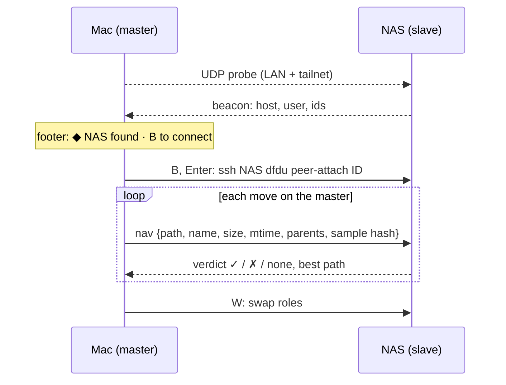

<picture>
  <source media="(prefers-color-scheme: dark)" srcset="https://raw.githubusercontent.com/jordond/dfdu/main/assets/logo/dfdu-logo-dark.svg">
  
</picture>

[](https://github.com/jordond/dfdu/actions/workflows/ci.yml)
[](https://github.com/jordond/dfdu/releases/latest)
[](https://crates.io/crates/dfdu)
[](https://github.com/jordond/dfdu/blob/main/LICENSE)
[](https://github.com/jordond/dfdu/blob/main/Cargo.toml)
[](https://scorecard.dev/viewer/?uri=github.com/jordond/dfdu)

A disk usage browser for the terminal and the desktop. Browse, sort and delete, see what your space is made of (caches, build output, emulators, containers), and get a list of what is safe to remove.

## This fork: peers

This is a fork of [jordond/dfdu](https://github.com/jordond/dfdu), branch `peer`. Two dfdu
instances, on one machine or two, bind as a pair to check backups by eye: as you walk files on
the **master**, the **slave** finds each file in its own scan and jumps to it. Design and
status: [peer/PLAN.md](peer/PLAN.md).



**Differences from upstream**

- **Peer mode is on by default** in the interactive browser (`--no-peer` turns it off). Each
  instance registers a private Unix socket in `~/.local/state/dfdu/peers/` (mode 0700/0600)
  and answers discovery probes on UDP 47839.
- **Discovery** by LAN broadcast and by unicast to online tailnet peers (`tailscale status
  --json`). A beacon carries no paths. It only offers a host to connect to.
- **Transport is always ssh** between hosts (`ssh -T -o BatchMode=yes HOST ~/.local/bin/dfdu
  peer-attach ID`), so a compromised LAN can't bind to you. Same host connects to the socket
  directly. Your own user only.
- **Matching on the slave:** same size, plus same name at any size, ranked by name, matching
  parent folders and mtime. Same-size candidates are checked in parallel with a sampled hash
  (xxh3-128 of the first and last 50 KiB plus the length).
- **Recent caches only:** cached scans load for 1 hour by default; set `DFDU_CACHE_MAX_AGE` to a duration such as `20m`, `1h` or `2d`.
- **Multiple roots:** `dfdu PATH PATH...` scans and browses several roots in one tree.
- **Image preview:** JPEG, PNG and ARW files get a kitty-graphics thumbnail beside the selected
  row (kitty and Ghostty auto-detected; `DFDU_IMAGE_PREVIEW=1` forces it on, `=0` off). The
  decoder is `~/.vim/jpg-preview`, a path dependency, so the fork builds only with that
  checkout present.
- **Builds:** dev and test builds use `line-tables-only` debug info; opt in to full debug info
  with `CARGO_PROFILE_DEV_DEBUG=true`. `make test` runs the suite, `make install` builds and
  copies to `~/.local/bin/dfdu`, and `make clean-debug` drops `target/debug`.

**Keys:** `B` connect (or unbind) · Enter binds the selected peer · `W` swap roles (master
only) · `C` focus the candidate list on the slave, Enter jumps, Esc returns.

**Install** on each machine: `make install` (needs `~/.vim/jpg-preview` beside it). Put
`~/.local/bin` before any upstream `dfdu` on your PATH. The remote side is always called as
`~/.local/bin/dfdu` (`--peer-remote-bin` overrides it).

**Try it**

1. **Image preview:** in Ghostty run `dfdu ~/Pictures` and move onto an image. A thumbnail
   appears after the name and goes away on other rows and views.
2. **Pair:** on the NAS run `~/.local/bin/dfdu --cross-mounts /pool/a /pool/b` (ZFS datasets
   are separate mounts). On the Mac run `dfdu ~/some/backed/up/folder`. Within seconds both
   footers show `◆ <host> found · B to connect`. Press `B` then Enter on the Mac. The Mac shows
   `master →`, the NAS `slave ←`.
3. **Walk:** move through files on the Mac. The NAS jumps to the best match, and its Candidates
   panel marks each with ✓ (sampled hash matches), ✗ (differs) or … (hashing). The Mac footer
   shows the verdict (`✓ 3 /path`, `none 0`). Browse the NAS freely; the next master move takes
   it back.
4. **Swap and leave:** `W` on the master flips roles. `B` unbinds; quitting either side leaves
   the other running unbound.

## Upstream dfdu


## Features

- **Fast.** Parallel scanning tuned to the storage device, and you can start browsing before it finishes.
- **Cleanup view.** Recognises caches, build folders, SDKs and old installers, says how safe each is to delete and how much it frees. [Rules](https://dfdu.app/docs/rules/) are extendable.
- **Treemap, tree mode, duplicates and largest files**, one key away from the list.
- **Opens last time's scan at once.** A repeat `dfdu PATH` shows the cached scan and refreshes only what changed.
- **History.** Every scan is recorded, so you can ask what grew since last week.
- **Remote.** Browse and delete on another machine over ssh.
- **Desktop app.** The same browser in a window for macOS, Linux and Windows, with the same keys as the terminal browser and a command palette.
- **Scriptable.** JSON and NDJSON output, a CI mode that fails above a size limit, and ncdu export import.
- **Safe by default.** Deletes go to the Trash; permanent deletes ask you to type `delete`. `--read-only` removes the delete keys.

## Install

```sh
curl -fsSL https://dfdu.app/install.sh | sh                 # macOS, Linux
brew install jordond/tap/dfdu                               # macOS, Linux
yay -S dfdu-bin                                             # Arch Linux
```

Windows:

```powershell
powershell -ExecutionPolicy Bypass -c "irm https://github.com/jordond/dfdu/releases/latest/download/dfdu-installer.ps1 | iex"
```

The desktop app:

```sh
brew install --cask jordond/tap/dfdu-gui                    # macOS
curl -fsSL https://dfdu.app/install.sh | sh -s -- --gui     # macOS, Linux, with the CLI
```

[The install docs](https://dfdu.app/docs/install/) cover release binaries, cargo, Nix, the install script's options, and the desktop app's downloads for Linux and Windows.

With an AI assistant, paste this prompt:

```text
Install dfdu for me. Follow the instructions at https://dfdu.app/llms.txt and pick the method that fits this machine.
```

## Usage

```sh
dfdu ~                    # browse a directory
dfdu --disks              # pick a disk first
dfdu --remote server /srv # another host over ssh
```

Keys follow ncdu. Press `?` in the app for the full list, or see [Browsing](https://dfdu.app/docs/usage/).

```sh
dfdu report ~/dev         # what the cleanup rules found
dfdu clean ~/dev          # dry run of the recommended deletes
dfdu diff ~ --since 7d    # what grew in the last week
```

[Command line](https://dfdu.app/docs/cli/) has the commands for scripts and CI, with JSON output and size limits.

## Docs

- [Install](https://dfdu.app/docs/install/): every install method, options and uninstalling
- [Browsing](https://dfdu.app/docs/usage/): keys, views, mounts and the scan cache
- [Command line](https://dfdu.app/docs/cli/): the commands for scripts and CI
- [Desktop app](https://dfdu.app/docs/desktop/): installing and using the desktop app
- [Cleanup rules](https://dfdu.app/docs/rules/): the built-in rules and how to write your own
- [Themes](https://dfdu.app/docs/themes/): five built-in themes and custom TOML themes
- [Benchmarks](https://dfdu.app/docs/benchmarks/): scan time and memory against other tools
- [Contributing](https://github.com/jordond/dfdu/blob/main/CONTRIBUTING.md): building, testing and releasing

## Similar tools

Other disk usage tools worth a look:

- [ncdu](https://dev.yorhel.nl/ncdu): the classic ncurses disk usage browser, whose keys dfdu follows
- [gdu](https://github.com/dundee/gdu): a fast disk usage analyzer with a console interface, written in Go
- [dua](https://github.com/Byron/dua-cli): disk usage analyzer with an interactive mode, written in Rust
- [Dust](https://github.com/bootandy/dust): a more intuitive version of `du`, written in Rust
- [pdu](https://github.com/KSXGitHub/parallel-disk-usage): parallel disk usage, written in Rust

## License

[MIT](https://github.com/jordond/dfdu/blob/main/LICENSE)
