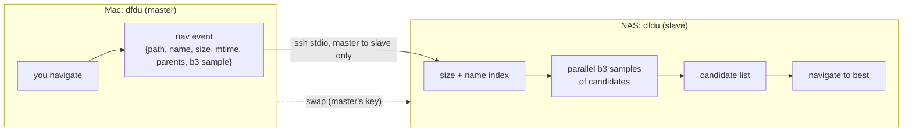
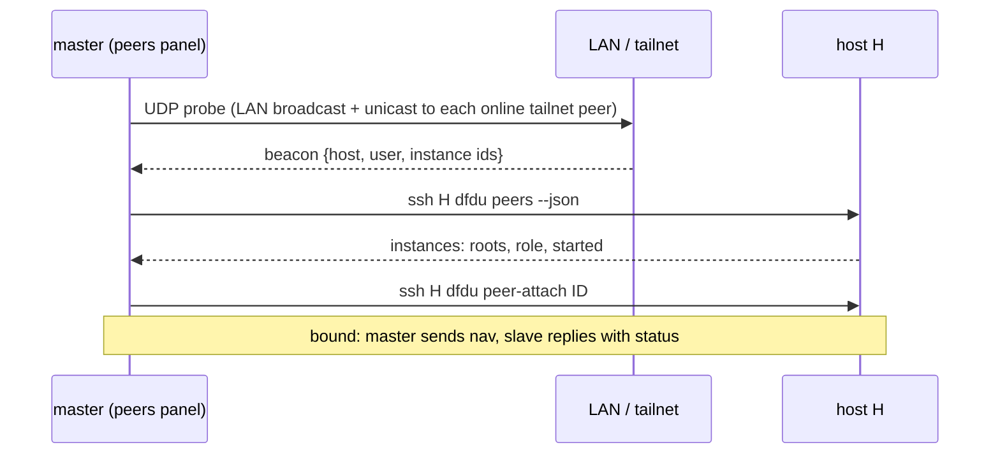
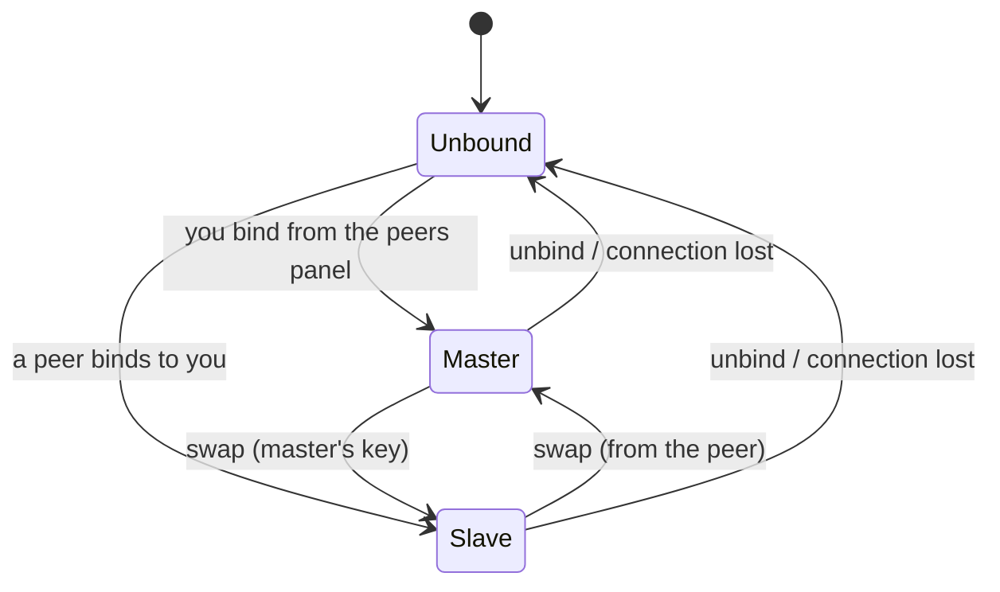
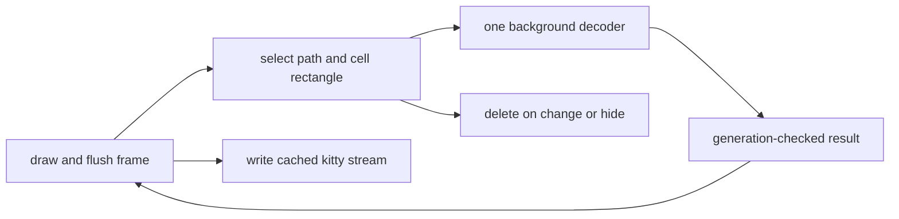

# dfdu peers

A lean fork of dfdu in which two dfdu instances, on the same machine or on different hosts,
bind as a pair. The **master** reports where you navigate. The **slave** finds the same file
in its own tree and navigates to it, with a list of other candidates. Purpose: walk a source
drive and confirm that every file has a backup on the NAS, by eye and by sampled hash.

This replaces the `scanner` branch design (shell orchestration of fzf, lf, ssh and env vars).
That branch stays as an archive.

## Shape

## Transport: always ssh

There is no network listener. Each instance in peer mode listens only on a Unix socket that
only you can open (`0600`, in the runtime or state directory, one per instance).

- **Remote peer:** the master runs `ssh -T -o BatchMode=yes HOST dfdu peer-attach ID`. The
  `peer-attach` subcommand connects that socket to stdin and stdout. Your ssh setup does the
  authentication: keys, host-key checks, `~/.ssh/config`.
- **Same host:** the master connects to the socket directly. Going through ssh would end at
  the same socket with the same file permissions, so it would add nothing.
- **Protocol:** newline-delimited JSON over that stream.
- **Scope:** your own user only. Other users over the internet are a later problem; ssh keys
  don't fit that case.

## Discovery: beacons are hints, never trust

- Each peer-mode instance answers probes on a fixed UDP port.
- The peers panel probes the LAN by broadcast, and each online tailnet peer by unicast. The
  list of tailnet peers comes from `tailscale status --json`.
- A beacon carries no paths, roots or secrets. A fake beacon can only add a host to the list.
  Anything beyond that goes through ssh, so the host key is checked first.
- Fallback: a manual `HOST` or `HOST ID` entry in the panel.

## Roles

- Only the master sends nav events. Your moves on the slave are never sent, so there is no echo.
- You can browse the slave freely. The next nav event from the master takes it over again.
- Only the master can trigger a swap. Afterwards the old slave sends and the old master follows.

## Matching on the slave

1. Candidates come from the in-memory index: the same size, plus the same name at any size.
2. Ranking: same size and name, then matching parent names (nearest first), then mtime.
3. The master sends its file's sampled b3 hash (first and last 50 KiB) as soon as it has it.
   The slave hashes its same-size candidates in parallel and marks each one ✓, ✗ or pending.
4. The candidate list view shows path, size, mtime and the hash mark, and updates as hashes
   finish. The cursor goes to the best candidate; Enter jumps to any other.
5. When a scan finishes, the last nav event is re-run unless you have moved since.

## Image preview

When the highlighted file is a JPEG, PNG or ARW, dfdu draws a kitty graphics placement next
to its row after each frame, with one fixed image id, and deletes it when the selection moves.
Both sides do this, so you can compare the pictures. The decoder is
`~/.vim/jpg-preview`, split into a library and used as a path dependency.
Layout is deliberately simple for now.

### Part C: UI wiring (complete)

The Files view (including tree mode) previews local, nonimported files in kitty, outside tmux
and screen. The list must be at least 40 columns wide. Placement starts in its right half,
beside the selected row, and fits within the remaining list area, at most 40 by 12 cells.
Other views, overlays and the debug panel hide it. Decode errors leave no image.

The UI writes graphics only after drawing. One worker decodes at a time; rapid moves retain
only the latest request, not a queue of old selections. Results carry the request and generation,
so changing away and back cannot accept old work. Each unchanged frame reuses the completed
stream. Selection or placement changes invalidate it. Quit, errors and reopen clear it; terminal
restoration and the panic hook also delete the fixed id before leaving the alternate screen.
A decoder still running at exit has no terminal writer and is not joined.

Tests cover asynchronous work, cached redraws, stale results, resize, failure and local-only
eligibility. A real PNG scan through the run loop checks completion wakeup, output after the
frame flush, and deletion on selection, view, overlay, quit and the reopen/suspend boundary.
No live kitty screenshot assertion is automated.

## Carried over from `scanner`

| Keep (cherry-pick or port) | Drop |
|---|---|
| Size/name match index, rebuilt on tree version change (`468bd15`, `24058e6`, `ac068d3`) | `DFDU_ON_SELECT` hook |
| Multiple roots (`5a215c2`..`ba6e16a`) | TCP `DFDU_LISTEN` / `DFDU_PEER` / `DFDU_PEER_FOLLOW` / `DFDU_PEER_KEY` |
| Channel into the TUI `select!` loop; JSON line envelopes | Two-way follow, yank key, echo guard |
| Re-match after a scan | scanner shell, preview.js, fzf and lf glue in `~/util` |

## Builds

`.cargo/config.toml` sets `debug = "line-tables-only"` for dev and test builds: small
artifacts and fast links. For real debugging, opt in with `CARGO_PROFILE_DEV_DEBUG=true`.
`make clean-debug` removes `target/debug`.

## Phases

Each phase starts with failing tests in their own commit, then green commits at each seam.

1. **Base + image preview.** Carry over the match index and multiple roots. Split jpg-preview
   into a library. Kitty placement next to image rows.
2. **Peer mode and transport.** Unix socket listener, `dfdu peer-attach`, `dfdu peers --json`,
   binding the same host and over ssh, unbind. Two-instance tests on one machine through the
   same code path.
3. **Discovery.** UDP probe and beacon, tailnet unicast, the peers panel, manual entry.
4. **Nav and matching.** Nav events, the candidate list view, parallel sampled hashes,
   re-match after a scan.
5. **Swap.**
