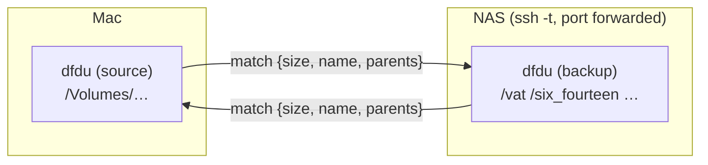
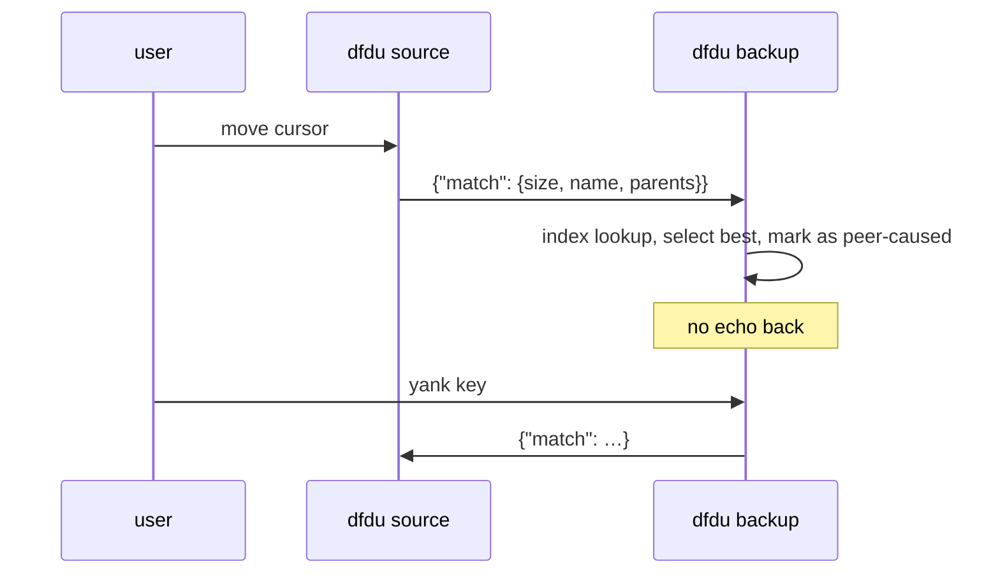

# dfdu as both ends of scanner

Scanner (`~/util/scanner`) compares a local source drive against backups on the NAS. Today:
lf (source) drives an fzf (backup index) over HTTP. Goal: dfdu on both ends, each holding its
tree in memory, linked so a match found on one side is shown on the other, in either direction.

Each side looks up matches in its own memory. Only small queries cross the link, never file lists.

## Pieces

| Piece | What it does |
|---|---|
| `DFDU_ON_SELECT` | `sh -c "$DFDU_ON_SELECT" dfdu-on-select <path>` when the selected path changes. Local trees only. |
| `--listen ADDR` | Line-delimited JSON over localhost TCP, with a shared key (`DFDU_PEER_KEY`). A reader thread feeds a channel into the `select!` in `dfdu-tui/src/run_loop.rs`. |
| Match index | Lazy `HashMap<size, Vec<Ix>>` built with `Tree::for_each_leaf`, rebuilt when `Tree::version()` changes. Rank: size + name, then size + parent names, then size only. |
| `match` command | Select the best candidate, show `1/N matches` in the status line, a key cycles. |
| `--peer ADDR` | Where this side sends its own `match` queries. |
| Follow / yank | Auto-follow source → backup on hover. A yank key sends one `match` from either side. |
| Echo guard | Selection moves caused by the peer never send a `match` back. |
| Compare line | The peer's size, mtime and b3 sample next to ours. Replaces the fzf preview pane. |
| Multiple roots | Several PATH arguments, one tree with several roots (`Tree::roots` is already a list). |

## Message flow

## Phases

Each phase starts with red tests committed, and ends green and usable on its own.

1. **On-select hook.** `DFDU_ON_SELECT`, plus `cmd_dfdu` in `~/util/file-browsing-tools/file_scanner.sh`. The fzf backend is unchanged. Swaps out lf.
2. **Listen + match.** `--listen`, the match index and the `match` command. Tested with plain TCP clients. Then the backend fzf becomes dfdu.
3. **Peer link.** `--peer`, the yank key, the echo guard. Full two-sided herdr e2e test.
4. **Compare line, multiple roots.** Then remove the fzf, lf and find-index paths from scanner. The dfdu scan cache may replace `scanner index` entirely.
