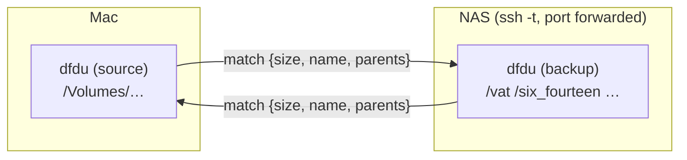
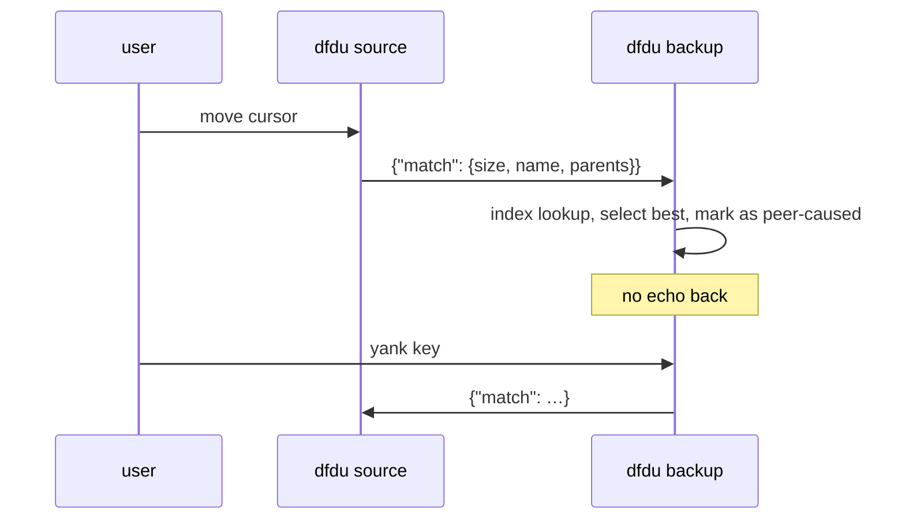

# dfdu as both ends of scanner

Scanner (`~/util/scanner`) compares a local source drive against backups on the NAS. Today:
lf (source) drives an fzf (backup index) over HTTP. Goal: dfdu on both ends, each holding its
tree in memory, linked so a match found on one side is shown on the other, in either direction.

Each side looks up matches in its own memory. Only small queries cross the link, never file lists.

## Pieces

| Piece | What it does |
|---|---|
| `DFDU_ON_SELECT` | `sh -c "$DFDU_ON_SELECT" dfdu-on-select <path>` when the selected path changes. Local trees only. |
| `DFDU_LISTEN=ADDR` | Line-delimited JSON over localhost TCP, with a shared key (`DFDU_PEER_KEY`). Requests: `match`, `next`, `prev`, `goto`, `state`. A reader thread feeds a channel into the `select!` in `dfdu-tui/src/run_loop.rs`. |
| Match index | Lazy `HashMap<size, Vec<Ix>>` built with `Tree::for_each_leaf`, rebuilt when `Tree::version()` changes. Rank: size + name, then size + parent names, then size only. |
| `match` command | Select the best candidate, show `1/N matches` in the status line, a key cycles. |
| `DFDU_PEER=ADDR` | Where this side sends its own `match` queries (persistent connection, background thread). `DFDU_PEER_FOLLOW=1` sends on every selection change. |
| Follow / yank | Auto-follow source → backup on hover. A yank key sends one `match` from either side. |
| Echo guard | Selection moves caused by the peer never send a `match` back. Also: re-run an unmatched or mid-scan `match` when the scan finishes, unless the user moved. |
| Compare line | The peer's size, mtime and b3 sample next to ours. Replaces the fzf preview pane. |
| Multiple roots | `dfdu PATH...`: one tree, a top-level root picker. No scan cache or history, no deletes. |

## Message flow

## Phases and status (2026-11-11)

Settings are env vars, not flags, so the generated man pages and completions stay untouched.

| Phase | State |
|---|---|
| 1. On-select hook (`DFDU_ON_SELECT`) + `scanner dfdu` frontend | Done. Verified end to end with a real fzf backend. |
| 2. Listen + in-memory match index | Done. `/opt/homebrew` (536k items): first match 28 ms, then under 1 ms. |
| 2b. Multiple roots; scanner `--backend dfdu` with `--cross-mounts` | Done. NAS: 4 pools, about 2.65M entries scanned in about 1 s (warm ZFS metadata); a real match over the ssh tunnel took 298 ms. The scan is fast enough that no cache is needed. |
| 3. Peer link, yank key (`Y`), echo guard, re-match after scan | Mostly done (`cc2de69`, `5dbc273`). Five review fixes left uncommitted (see below). Scanner does not yet set `DFDU_PEER`/`DFDU_LISTEN` on the source side, so the backend cannot yet send back to the Mac. |
| 4. Compare line (peer size, mtime, b3), then remove fzf, lf and the find index from scanner | Not started. |

Open review findings for phase 3:
1. After a peer request, the loop can sleep up to the idle wait before applying the move.
2. `next`/`prev` during a scan can be overridden by a retry when the tree changes.
3. The echo-guard target can persist if its destination disappears.
4. The peer connection tries only the first resolved address.
5. Peer reply reads are unbounded.
